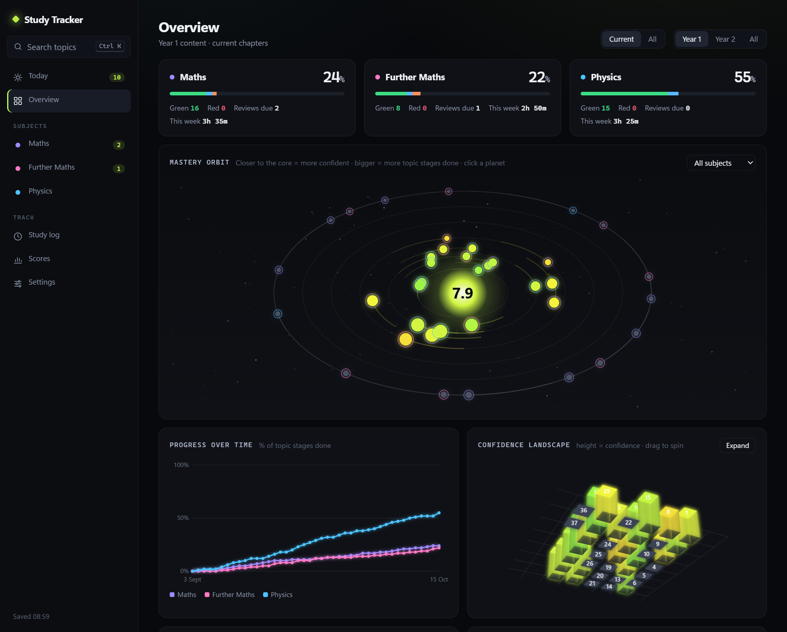

# Study Tracker

A desktop app I use to track my A-level revision for Maths, Further Maths and Physics. It knows every chapter and topic in my courses, tells me what to review each day, and turns my progress into a few charts that are more fun to look at than a spreadsheet.



*The overview page running on made-up demo data (`python app.py --demo`).*

## What it does

- **Every topic in the course.** Edexcel Maths (9MA0), Edexcel Further Maths (9FM0, FM1 + D1) and OCR Physics A (H556), split into chapters and topics. Each topic moves through *Taught → Notes → Practised → Confident*.
- **Red / amber / green reviews.** Rating a topic schedules it to come back: red after 2 days, amber after 7, green after 21. The Today page lists what's due, what still needs notes, and what hasn't been rated yet.
- **Study log.** Log sessions by hand, run a timer, or let it log automatically while you rate topics. Shows a weekly total and the last 8 weeks.
- **Scores.** Class tests, homework and mocks, plotted over time per subject.
- **Visuals** (all drawn on a canvas, no chart library):
  - *Mastery orbit*: each chapter is a planet. The more confident I am, the closer it orbits to the core, and the more topic stages are done, the bigger it is. Click a planet to jump to that chapter.
  - *Confidence landscape*: a 3D bar grid of every chapter, height = confidence. Drag to spin it.
  - *Progress over time*: % of topic stages done per subject, from a daily snapshot.
- **Revision links.** Chapters and topics link to the matching Physics & Maths Tutor and Maths Genie pages where there is one. Every link was checked when the list was built.
- **Ctrl K search** across all topics.
- **Backups.** A daily backup (last 30 kept), manual backups, restore, export and import.

## How it works

- `app.py` is a small local web server using only the Python standard library. It listens on `127.0.0.1` only, and every API call needs a random token, so other programs and websites can't read or change the data.
- The UI opens in a Microsoft Edge (or Chrome) app window with no address bar, so it feels like a normal desktop app. The server shuts itself down once the window has been closed.
- The front end is plain HTML, CSS and JavaScript with no build step and no dependencies.
- Data is saved to `data/data.json` with atomic writes. If the file is ever corrupted, the app keeps a copy of it and warns you to restore a backup.
- If `data-location.txt` exists, its single line is used as the data folder instead (I point mine at OneDrive so it's backed up off the PC).
- The curriculum lives in `curriculum/*.json`, separate from my progress, so courses can be edited without touching anyone's data.

## Running it

You need Windows and Python 3 (I use 3.12). There's nothing to install.

```
python app.py            # or double-click "Start Study Tracker.bat"
python app.py --demo     # try it with made-up data ending today
```

`--demo` makes six weeks of fake study data in a temporary folder, so it never touches real data. The same data is also in [`demo/data.json`](demo/data.json) if you want to import it from Settings. To serve it without opening a window (e.g. to view it in a normal browser):

```
python app.py --no-window --port 8765 --token preview --data-dir <some folder>
```

then open `http://127.0.0.1:8765/#preview`.

## Project layout

```
app.py                    local server, storage, backups, the app window
web/                      the UI: index.html, app.js, visuals.js (canvas charts), style.css
curriculum/               course definitions + checked revision links (resources.json)
demo/data.json            sample data used for the screenshot
tools/make_demo_data.py   generates the demo data by simulating a term of study
tools/build_resources.py  rebuilds resources.json from saved PMT / Maths Genie pages
tools/explore.py          dumps links from index pages when mapping new resources
```

## Notes

- The course lists were written from the textbook structure and the specs, and haven't all been checked line by line against the official spec PDFs yet. Each subject file says so in its `source` field.
- Windows only for now (it uses the Windows API to tell when the window has closed). The UI itself would run anywhere.
